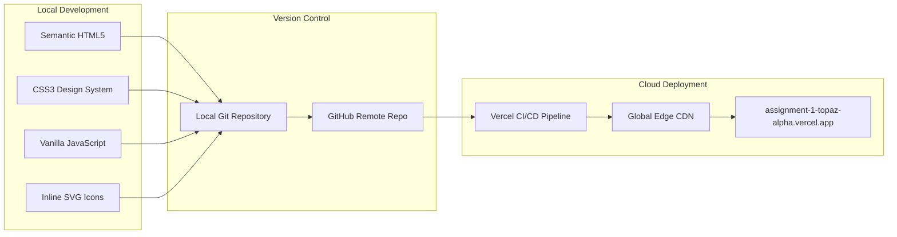
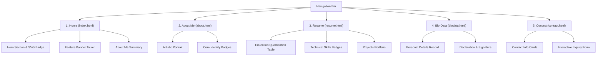

# Project Report: Personal Portfolio, Resume & Bio-Data Web Application

**Course / Subject:** Web Technology / Internet Technology Laboratory  
**Assignment:** Assignment 1 – Personal Website, Bio-Data & Resume Development  
**Student Name:** Cynthia Alexander  
**Degree / Institution:** Bachelor of Engineering (B.E.), Jain College, Hubli, Karnataka  
**GitHub Repository:** [cynthiaalexandergeorge-create/assignment-1](https://github.com/cynthiaalexandergeorge-create/assignment-1)  
**Live Production URL:** [https://assignment-1-topaz-alpha.vercel.app](https://assignment-1-topaz-alpha.vercel.app)  
**Date of Submission:** November 2026  

---

## 1. Executive Summary

This project delivers a multi-page personal portfolio, curriculum vitae, and bio-data web application designed to meet and exceed academic web development specifications. The website provides a modern, responsive digital identity for **Cynthia Alexander**, an engineering student at Jain College, Hubli.

Starting from foundational laboratory reference code and structural specifications, the platform was re-engineered following contemporary UI/UX design principles, semantic HTML5, modern CSS3 layout paradigms (Flexbox and CSS Grid), vanilla JavaScript for DOM interactivity, and pure SVG vector graphics. The final project is version-controlled via Git, hosted on GitHub, and continuously deployed to the cloud using Vercel.

---

## 2. Technology Stack & Tools

| Component | Technology / Tool | Purpose & Usage |
| :--- | :--- | :--- |
| **Markup** | HTML5 | Semantic page structure, accessibility, metadata, and form controls |
| **Styling** | CSS3 (Vanilla) | Custom CSS variables, responsive Grid & Flexbox, CSS animations, media queries |
| **Scripting** | JavaScript (ES6+) | Mobile navigation toggle, contact form submission handling, alert dialogs |
| **Graphics** | SVG (Scalable Vector Graphics) | Crisp, resolution-independent vector icons and circular animated badges |
| **Photography** | Web-optimized JPG | High-resolution portfolio and portrait assets |
| **Version Control** | Git & GitHub | Distributed version tracking, branch management (`main`), remote repository |
| **Hosting & CI/CD** | Vercel Edge Network | Automated cloud build, SSL certification, global CDN distribution |

---

## 3. Website Architecture & Modules

The web platform is structured into five cohesive pages linked via a persistent, responsive navigation bar.

### 3.1 Home Page (`index.html`)
The landing experience establishes professional credibility through a clean hero banner:
* **Brand Monogram Logo:** High-contrast `C` emblem leading into the brand identifier.
* **Hero Banner:** Features an electric-lime highlight tag (`Hello I Am`), bold typography (`I'm Cynthia`), and an introductory mission statement.
* **Rotating Vector Badge:** A custom SVG circular text path (`SOFTWARE ENGINEERING • CYNTHIA •`) executing continuous 360° keyframe animation around a high-resolution portrait.
* **Action Triggers:** Call-to-action buttons ("View Resume", "Get in Touch") and direct social media profile links (Email, LinkedIn, GitHub) built with inline SVG vectors.
* **Feature Ticker Strip:** Obsidian-black banner with lime star glyphs highlighting core domains: *Software Engineering*, *AI & Federated Learning*, *Web Architecture*, and *Problem Solver*.
* **Embedded About Preview:** Provides a natural narrative transition to the extended biography.

### 3.2 About Me (`about.html`)
Dedicated to professional self-presentation:
* **Visual Anchor:** High-contrast studio portrait.
* **Academic Narrative:** Explains the candidate's engineering background at Jain College, focus on clean architecture, and passion for distributed AI systems.
* **Core Identity Badges:** Capsule pills highlighting:
  * `Software Engineering Student`
  * `Tech Enthusiast`
  * `Problem Solver`
  * `Quick Learner`
  * `Hubli, Karnataka`

### 3.3 Resume / Curriculum Vitae (`resume.html`)
Presents academic and technical competencies in a structured, standard format:
* **Personal Summary:** Name, verified email (`cyntalex@gmail.com`), phone (`+91 8972639101`), and location (`Hubli, Karnataka`).
* **Career Objective:** Clear statement of professional intent in software engineering.
* **Educational Qualification Table:**
  | Qualification | Institution | Year | Percentage |
  | :--- | :--- | :---: | :---: |
  | **B.E. (Software Engineering)** | Jain College | 2026 | **85%** |
  | **PUC (Pre-University)** | Adarsh College | 2022 | **80%** |
  | **SSLC (10th Standard)** | Government School | 2020 | **90%** |
* **Technical Skills:** C Programming, HTML & CSS, JavaScript, Python, Database Management, and AI & Federated Learning.
* **Project Portfolio:**
  1. *Student Management System:* Academic record management and grading platform.
  2. *Food Waste Management System:* Community food redistribution coordination platform.
  3. *AI in Federated Learning:* Privacy-preserving decentralized machine learning system.
* **Achievements & Hobbies:** Coding competitions, workshops, and interests in reading and music accompanied by stroke-based SVG icons.

### 3.4 Bio-Data Page (`biodata.html`)
Formats official verification records according to formal Indian institutional requirements:
* **Structured Details Table:** Full Name, Date of Birth (`01 January 2006`), Gender (`Female`), Nationality (`Indian`), Languages Known (`English, Kannada, Tamil, Hindi`), Residential Address, and Contact details.
* **Formal Declaration:** Affirmation of accuracy as required by official bio-data protocols.
* **Sign-off Block:** Place (*Hubli*), Submission Date (*25/09/2026*), and an emphasized cursive typographic signature (*Cynthia Alexander*).

### 3.5 Contact Page (`contact.html`)
A direct communication portal:
* **Information Cards:** Individual cards for Email, Telephone, Geographic Location, and Academic Internship Status.
* **Interactive Message Form:** Includes fields for Name, Email, Subject, and Multi-line Message with instant client-side validation and confirmation feedback.

---

## 4. Key Design & Engineering Techniques

### 4.1 Pure SVG Vector Design (Elimination of Casual Emojis)
To ensure professional presentation suitable for employer and faculty evaluations:
* All casual platform emojis were completely replaced with resolution-independent **Scalable Vector Graphics (SVG)**.
* Icons use stroke-based geometry (`viewBox="0 0 24 24"`, `fill="none"`, `stroke="currentColor"`) matching modern design system standards (such as Feather and Lucide icons).
* SVG vectors inherit parent color hierarchies dynamically via `currentColor`.

### 4.2 CSS Design Tokens & Color Palette
The stylesheet utilizes CSS custom properties for cohesive theming:
* **Primary Coral Accent (`#ff5e62`):** Delivers visual energy to call-to-actions, active links, and brand icons.
* **Electric Lime (`#ccff00`):** Acts as a high-visibility accent on badges and highlights.
* **Obsidian Black (`#090a0f`):** Provides anchor contrast for ticker bars and page footers.
* **Neutral Slate Scale (`#0f172a`, `#334155`, `#64748b`, `#f8fafc`):** Ensures high-contrast typography adhering to WCAG 2.1 AA accessibility standards.

### 4.3 Responsive Web Design (RWD)
* **Fluid Layouts:** Uses CSS Grid with `repeat(auto-fit, minmax(...))` and Flexbox wrappers.
* **Mobile Breakpoints (`@media (max-width: 900px)` & `@media (max-width: 650px)`):**
  * Desktop multi-column grids collapse into single-column vertical stacks.
  * Wide data tables gain horizontal scrolling wrappers to prevent viewport clipping.
  * Desktop navigation transitions into an accessible mobile slide-down menu.

---

## 5. Deployment Pipeline & Verification

### 5.1 Version Control & Git Workflow
1. Initialized local Git repository with `.gitignore` covering extraneous and binary cache files.
2. Formatted commits with descriptive messages documenting structural, content, and stylistic changes.
3. Created default deployment branch `main`.
4. Connected and synchronized with remote repository `cynthiaalexandergeorge-create/assignment-1`.

### 5.2 Vercel Cloud Deployment
* Linked GitHub repository directly to Vercel via automated webhooks.
* Configured static output build with automated HTTPS provisioning.
* Verified that every subsequent commit pushed to `origin/main` automatically triggers a zero-downtime production deployment.

### 5.3 Endpoint Status Verification

All five public endpoints were verified via automated HTTP requests:

| Route | Live URL | HTTP Status |
| :--- | :--- | :---: |
| **Home** | `https://assignment-1-topaz-alpha.vercel.app/` | **200 OK** |
| **About** | `https://assignment-1-topaz-alpha.vercel.app/about.html` | **200 OK** |
| **Resume** | `https://assignment-1-topaz-alpha.vercel.app/resume.html` | **200 OK** |
| **Bio-Data** | `https://assignment-1-topaz-alpha.vercel.app/biodata.html` | **200 OK** |
| **Contact** | `https://assignment-1-topaz-alpha.vercel.app/contact.html` | **200 OK** |

---

## 6. Conclusion

The developed personal portfolio successfully achieves all requirements set forth in the college assignment while elevating the output into a professional-grade web application. Through clean code separation (HTML structure, CSS presentation, JavaScript behavior), vector-first graphic design, and automated cloud hosting on Vercel, the website serves as both an academic deliverable and an active professional portfolio.
